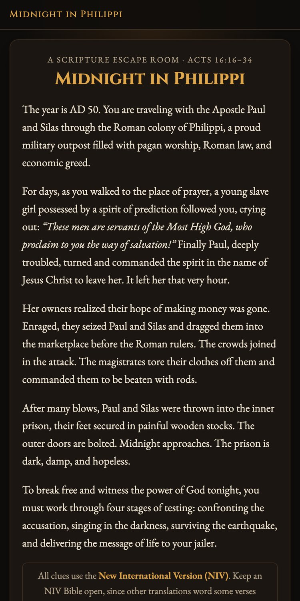
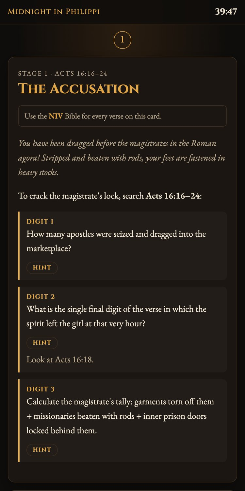

# Narrow Gate

Scripture escape rooms for youth groups. Teams open a game on a phone or laptop, solve each stage's clues using an NIV or NKJV Bible, and enter the code to unlock the next stage.

**Live site:** https://narrow-gate.onrender.com (hosted on Render's free plan, so the first visit may take up to a minute while the server wakes up)

## The escape rooms

| Game | Passage | Stages | Time | Difficulty | Address |
|---|---|---|---|---|---|
| **Midnight in Philippi** | Acts 16:16–34 | 4 | 40 min | 2.5 / 5 | `/philippi/` |
| **The Secret of Susa** | Esther 2–9 | 4 | 40 min | 4 / 5 | `/susa/` |

The Secret of Susa's clue cards give no chapter or verse references: teams find their own way through Esther 2–9.

More are on the way.

<table>
  <tr>
    <td></td>
    <td></td>
    <td></td>
    <td></td>
  </tr>
  <tr>
    <td align="center">Start</td>
    <td align="center">Clues and hints</td>
    <td align="center">Flip-card puzzle</td>
    <td align="center">Escape</td>
  </tr>
</table>

**Leading a group?** See [LEADERS.md](LEADERS.md) for how to run the night and the leader passcode for the answer keys.

## Built with

- **Django 5.2** (Python): views, templates and server-side code checking
- **Vanilla CSS and JavaScript**: themed mobile-first design, CSS-only unlock animations, countdown timer
- **WhiteNoise** for static files and **Gunicorn**, deployed on **Render** from a `render.yaml` blueprint
- **Signed-cookie sessions** instead of a database, so it runs on free hosting with nothing to maintain

## Features

Every game gets all of these. Addresses below are for Midnight in Philippi; other games use their own slug in place of `philippi`.

- A home page listing every escape room, each with **Play** and **Lead** buttons, plus an about page.
- Stages and a victory screen, with a short unlock animation and sound between each.
- An **NIV / NKJV** switch: teams choose their Bible once, and every card shows that translation's wording.
- Optional hints on each clue, hidden until a player taps them.
- Sound effects synthesized in the browser with the Web Audio API (no audio files), with a mute button in the header.
- A countdown timer on each team's phone.
- Codes ignore case, spaces and dashes (`2-8-4`, `2 8 4` and `284` all work), and are checked on the server so they never appear in the page source.
- No database. Each device's progress is stored in a signed cookie, separately for each game, so many teams can play at once.
- A reset button on the victory screen clears a device for the next team.
- A leader page at `/philippi/lead/` with the run of the night, the player QR code and links to everything below.
- A passcode-protected answer key at `/philippi/lead/answers/`.
- A projector backdrop at `/philippi/backdrop/` with a room countdown, ambient sound, a QR code for players to join, and links to the story and debrief. Keys: <kbd>I</kbd> story, <kbd>Space</kbd> start/pause, <kbd>E</kbd> earthquake (Midnight in Philippi only), <kbd>Q</kbd> QR code, <kbd>T</kbd> timer on/off, <kbd>S</kbd> sound on/off, <kbd>D</kbd> debrief, <kbd>F</kbd> full screen, <kbd>R</kbd> reset. Add `?timer=off` to hide the clock or `?minutes=45` for a different game length.
- Story mode at `/philippi/story/`: the backstory as a captioned "film" for the projector, with music and sound. It ends with **Start the game**, which starts the backdrop's room timer. Keys: <kbd>Space</kbd> play/pause, <kbd>→</kbd>/<kbd>←</kbd> next/back, <kbd>R</kbd> restart, <kbd>B</kbd> backdrop.
- Debrief slides at `/philippi/debrief/`: the discussion questions, one per screen. Keys: <kbd>→</kbd>/<kbd>←</kbd> (or a presentation clicker), <kbd>B</kbd> backdrop, <kbd>F</kbd> full screen.

The site's old single-game addresses (`/play/`, `/backdrop/` and so on) redirect to Midnight in Philippi.

## Project layout

| Path | Contents |
|---|---|
| [game/games/](game/games/) | One Python file per escape room, plus the shared building blocks in `base.py` |
| [game/games/philippi.py](game/games/philippi.py) | Midnight in Philippi: stages, codes, answer key, story captions, backdrop narration |
| [game/templates/game/games/philippi/](game/templates/game/games/philippi/) | Its clue cards, intro story, victory quote, story scenery, debrief questions and leader tips |
| [game/games/susa.py](game/games/susa.py) and [game/templates/game/games/susa/](game/templates/game/games/susa/) | The Secret of Susa, laid out the same way |
| [game/templates/game/](game/templates/game/) | Pages shared by every game |
| [game/static/game/](game/static/game/) | Shared CSS and JavaScript: sound, animations, projector pages |
| `docs/` | Source material for each game (kept out of the public repo) |

## Adding an escape room

1. Copy `game/games/philippi.py` to `game/games/<name>.py`. Give it a new `slug` (used in its addresses), then replace the title, passage, stages, answers, answer key, story scenes and backdrop lines.
2. Copy `game/templates/game/games/philippi/` to `game/templates/game/games/<slug>/` and rewrite each file: one `stages/stage_N.html` card per stage, plus `intro_story`, `freedom_quote`, `story_scenery`, `debrief_questions` and `lead_tips`.
3. Add the game to the list in `game/games/__init__.py`. It then appears on the home page.
4. Run `python manage.py test`.

Some shared pieces come in more than one style, chosen in the game's file:

- `room`: the projector backdrop's scenery and ambient sound. `"cell"` is a prison cell with dripping water (Midnight in Philippi); `"palace"` is a Persian palace hall with plucked strings (The Secret of Susa).
- `earthquake`: whether the backdrop has the <kbd>E</kbd> earthquake cue.
- `time_up_line`: the backdrop's line when the room timer runs out.
- `difficulty`: out of 5, in steps of 0.5, shown as a meter on the home, start and leader pages.
- `show_references`: set to `False` to hide each stage's Bible reference from players (the answer key still shows it).
- Each stage's `Entrance` scene: `dark`, `songs`, `quake`, `torch`, `doors`, `scroll`, `night` or `seal` (see `entrance.html`).

A game set somewhere new may need another room or unlock scene, which means a small change to the shared code.

## Run locally

```sh
python3 -m venv .venv
source .venv/bin/activate
pip install -r requirements.txt
python manage.py runserver
```

Open http://127.0.0.1:8000. Run the tests with `python manage.py test`.

## Settings

| Variable | Purpose |
|---|---|
| `DJANGO_SECRET_KEY` | Required in production. It signs the progress cookies. When it is set, debug mode is off. |
| `DJANGO_ALLOWED_HOSTS` | Comma-separated domain names, e.g. `example.com`. Render's hostname is added automatically. |
| `LEADER_CODE` | Passcode for every game's answer key. Locally it defaults to `philippi`. Without it in production, the answer keys stay locked. |
| `DJANGO_DEBUG` | Set to `1` or `0` to override the default. |
